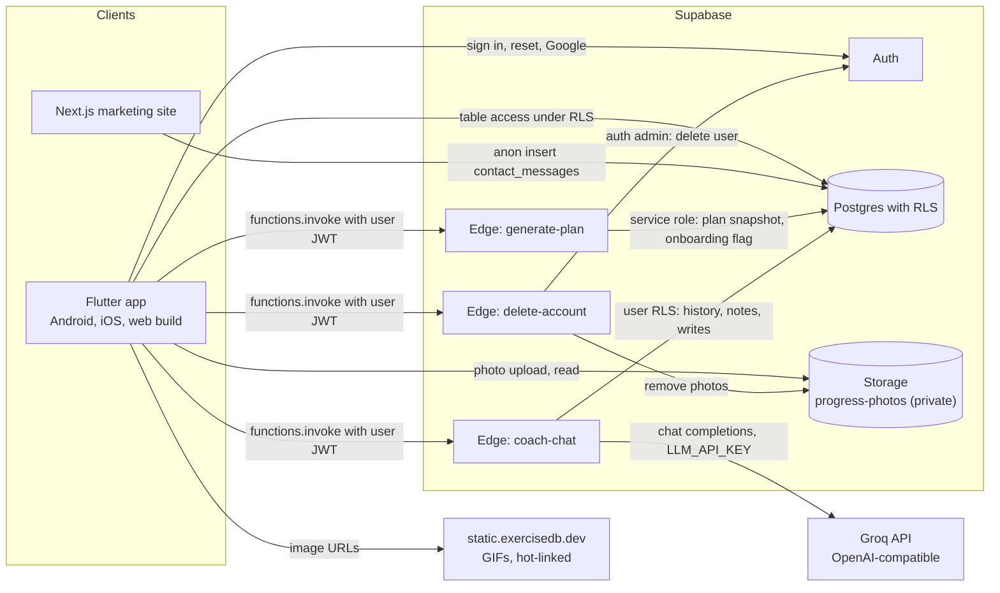
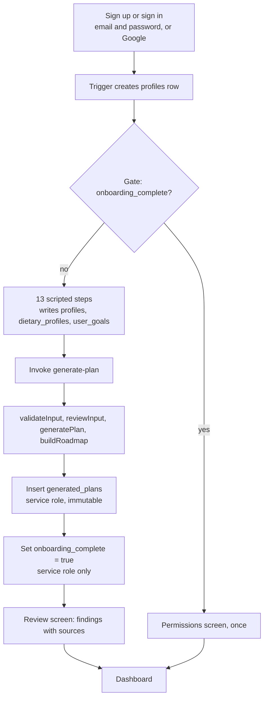
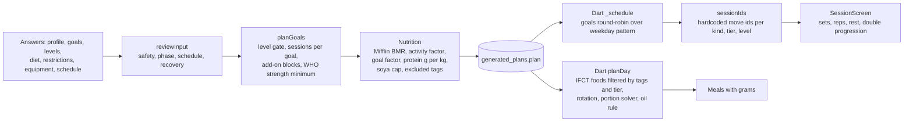

# Levlofit: Complete Project Audit

**Audit date:** 2026-10-12
**Repository:** `C:/Projects/Fitness App` (git branch `master`, HEAD `704751d` "Initial commit", one commit)
**Scope:** Read-only audit. No application file, database record, package or migration was changed. The only file written is this one.

---

## 0. Read this first: mismatch between the brief and the repository

The audit brief describes a system built on Grok, a "Rudra AI" assistant, The Fitness Wiki, embeddings and vector databases, a web app and mobile app both talking to a backend, and Android and iOS code. Several of those names are not in this repository:

| Brief says | What the repository actually contains |
|---|---|
| Grok API / "Rudra AI" | **Groq** (an OpenAI-compatible API, not Grok) behind a Supabase Edge Function named `coach-chat`. The assistant is branded **Levlofit AI**. The name "Rudra" appears nowhere. |
| The Fitness Wiki | **Not present.** No reference, import or citation to it in code, data or docs. |
| Embeddings / vector DB / RAG | **Not present.** `supabase/config.toml` has `[storage.vector] enabled = true`, which is a Supabase local default; no code uses it. The assistant receives handbook chapter titles and summaries as plain text. |
| Scraping | **Not present.** The data scripts in `data/` make no network calls (checked). |
| Web app talking to a backend | The **Next.js marketing site** (`website/`) makes exactly one backend call: an anonymous insert into `contact_messages`. The full product is the **Flutter app** (Android, iOS, and a web build). |
| Android and iOS implementations | Both are present as Flutter scaffolds (`app/android`, `app/ios`). Native code is minimal (see section 11). |

Every section below documents what exists and marks what does not. Where the brief assumed something that is absent, the section says "Not present".

---

## 1. Product overview

**Purpose.** Levlofit is an India-first fitness coaching app. Its stated differentiator is teaching rather than tracking: a chaptered "Handbook" built from a source-cited curriculum, plus a plan that is assessed and generated by a rules engine. Sources: `docs/PLAN.md`, `DESIGN.md`.

**Target users.** Adults in India training for general fitness, strength or muscle, calisthenics, running, HYROX, boxing, mobility or yoga. The engine rejects anyone under 18 or over 80 (`supabase/functions/_shared/plan-engine.ts:264`). Diet options are vegetarian, eggitarian, vegan and non-vegetarian. Beef and pork are excluded for everyone (`plan-engine.ts:171`).

**Implemented features (verified in code):**
- Email and password sign-up and sign-in, password reset, Google sign-in shown only when the provider is enabled (`app/lib/auth_screen.dart`).
- 13-step scripted onboarding that ends with a server-generated plan and a review screen (`app/lib/onboarding.dart`).
- Dashboard with a today view, a weekly schedule, the plan, a diet day built from Indian foods, hydration, habits, a calendar, progress (weight, tape measurements, body fat, photos), BMI calculator, body-fat calculator, reminders, a handbook reader, an exercise library, a glossary, settings, and profile (`app/lib/dashboard.dart`, `dashboard_tabs.dart`, `dashboard_menu.dart`).
- Guided workout sessions with set logging, rest timers and double-progression hints (`app/lib/session.dart`).
- Levlofit AI chat with threads, edit-and-regenerate, and a memory the user can clear (`app/lib/coach_chat.dart`, `supabase/functions/coach-chat/index.ts`).
- In-app account deletion, which removes progress photos from storage and then the auth user (`supabase/functions/delete-account/index.ts`).
- Marketing site with home, privacy and terms pages, and a contact form (`website/`).

**Unfinished or absent features (verified):**
- No payments. The plan is free and the README-equivalent docs say subscriptions come later.
- No push notifications. Reminders are local notifications only (`app/lib/reminders.dart`).
- Waitlist table exists (`supabase/migrations/20260929190000_waitlist.sql`) but **no code in `app/`, `website/` or `supabase/functions/` writes to it.**
- The exercise catalogue import function is commented out in its migration (`supabase/migrations/20260929230000_exercises_catalog.sql:36-64`), so the `exercises` table cannot be rebuilt from migrations alone.
- `coachLedFromLevel` is stored and passed through but never enforced (section 5).
- Injuries are collected and shown as a text finding but do not change exercise selection (section 7).
- Strength add-on blocks and extra strength sessions computed by the engine are not displayed or scheduled (section 7, finding F-05).

**Known problems:** see section 14 for the evidence-based list.

---

## 2. Technology architecture

| Layer | Actual choice (from code) | Evidence |
|---|---|---|
| Mobile and desktop UI | **Flutter** (Dart SDK `^3.13.4`), package name `levlo`, Android application id `com.levlofit.app` | `app/pubspec.yaml:1,22`, `app/android/app/build.gradle.kts:21` |
| Key Flutter packages | `supabase_flutter ^2.17.2`, `google_fonts 8.0.0`, `flutter_svg`, `http`, `flutter_local_notifications`, `flutter_timezone`, `audioplayers`, `shared_preferences` (used only in `main.dart`) | `app/pubspec.yaml:37-45` |
| Marketing site | **Next.js 16.3.6** with **React 19.2.8** and **Tailwind CSS 4**, TypeScript, ESLint 9 | `website/package.json` |
| Backend | **Supabase**: Postgres, Auth, Storage, Edge Functions (Deno) | `supabase/config.toml`, `supabase/functions/` |
| Edge function framework | `npm:@supabase/server@^1` imported as `withSupabase` (a semver range, not pinned) | `supabase/functions/*/index.ts:10`, `:5` |
| Database | Postgres with row level security on every user table | `supabase/migrations/*.sql` (23 files, plus 4 untracked) |
| Storage | One private bucket, `progress-photos`, 8 MB limit, JPEG/PNG/WebP only | `supabase/migrations/20261003200000_threads_measurements_photos.sql:43-46` |
| AI provider | **Groq** by default, via any OpenAI-compatible endpoint (`LLM_BASE_URL`); default model `openai/gpt-oss-120b` | `supabase/functions/coach-chat/index.ts:12-13` |
| Exercise media | Hot-linked GIFs from `static.exercisedb.dev` (ExerciseDB free V1, non-commercial licence) | `media/SOURCES.md`, `app/lib/exercises.dart:2` |
| Nutrition data | IFCT 2017 (NIN, India) for most foods; USDA FoodData Central for soya chunks | `data/build_foods.py:1-5`, `supabase/migrations/20261007100000_soya_chunks.sql:1-2` |
| Hosting | Supabase cloud project in `ap-south-1` (per comment in `main.dart:15`). Website hosting not configured in the repo; `docs/PLAN.md` says Cloudflare Pages was intended. | `app/lib/main.dart:15`, `docs/PLAN.md:20` |
| Auth | Supabase Auth: email and password, Google OAuth, password recovery | `app/lib/auth_screen.dart`, `supabase/config.toml:154-230` |
| Notifications | `flutter_local_notifications` (on device). No FCM or APNs. | `app/lib/reminders.dart` |

**How clients talk to the backend:**
- The Flutter app initialises `supabase_flutter` with a URL and a publishable key (`app/lib/main.dart:17-24`) and then uses three paths: direct table access under RLS (`supabase.from(...)`), Edge Function calls (`supabase.functions.invoke(...)`), and storage uploads. Edge Function calls send the signed-in user's JWT.
- The website calls the Supabase REST endpoint directly with the publishable key to insert into `contact_messages` (`website/src/components/contact.tsx:94-96`).
- No client talks to Groq directly. Only `coach-chat` does, and it holds the key.

---

## 3. Repository map

Tracked files total 207 (`git ls-files`). Untracked and modified files are listed in section 17.

### Top level
| Path | Responsibility |
|---|---|
| `docs/PLAN.md` | Build plan, rationale, phases, status (dated 2026-09-28). |
| `DESIGN.md` | Design tokens, components, bans. Every UI task is meant to read it. |
| `media/SOURCES.md` | Licence record for exercise media. |
| `brand/` | Logo SVGs. |
| `Refrence/` | Source curriculum PDF (not read in this audit; see section 17). |
| `.claude/` | Claude Code settings and a Playwright skill. `serve_web.py` is a local web helper. Tooling, not product code. |
| `.claude-flow/`, `graphify-out/` | Tool state, git-ignored (`.gitignore:42`, `:43`). |
| `.gitignore` (root) | Ignores `.claude-flow/` and `graphify-out/` (`.gitignore:42-43`). `app/.gitignore` ignores `.dart_tool/`; `website/.gitignore` ignores `node_modules`. |

### `app/`: Flutter app
| File | Lines | Responsibility |
|---|---|---|
| `lib/main.dart` | 289 | Entry point. Supabase init, theme, splash, `PermissionsScreen`, `Gate` (signed out → auth; no completed onboarding → onboarding; otherwise dashboard). |
| `lib/auth_screen.dart` | 438 | Sign in, sign up, Google button (shown only if the auth settings endpoint reports Google on), forgot password, `SetPasswordScreen`. |
| `lib/onboarding.dart` | 1147 | 13-step scripted onboarding, validation, save, `generate-plan` call, review screen. |
| `lib/dashboard.dart` | 1195 | Shell, data loading, `_schedule()` weekly scheduler, today tab, profile edit (height/weight edit triggers plan regeneration). |
| `lib/dashboard_tabs.dart` | 1738 | Workout, protocol, diet, hydration, habits, calendar, progress, foods, body-fat, level check, reminders. |
| `lib/dashboard_menu.dart` | 1632 | Navigation drawer, plan page, library, glossary, settings, profile. |
| `lib/diet_plan.dart` | 280 | Meal builder: IFCT food catalogue, meal templates, portion solver, oil rule, budget tiers. |
| `lib/session.dart` | 712 | Workout moves by kind, tier and level; sets and reps; rest; double progression; session screen. |
| `lib/exercises.dart` | 321 | Exercise library and detail screens (GIF, muscles, instructions). |
| `lib/coach_chat.dart` | 979 | Levlofit AI chat UI, threads, edit and regenerate, memory view and clear. |
| `lib/handbook.dart` | 904 | Handbook reader. Renders visual blocks from `handbook_chapters.blocks`. |
| `lib/reminders.dart` | 178 | Local notification scheduling. |
| `lib/tools.dart` | 304 | BMI calculator and US Navy body-fat calculator. |
| `lib/theme.dart`, `lib/icons.dart`, `lib/mark.dart`, `lib/avatar.dart` | 307, 56, 104, 164 | Theme, icons, logo animation, avatar picker. |
| `test/*.dart` | 6 files | See section 13. |
| `android/app/src/main/AndroidManifest.xml` | | Permissions: `INTERNET`, `POST_NOTIFICATIONS`, `RECEIVE_BOOT_COMPLETED`. Deep link scheme `com.levlofit.app`, host `login-callback`. |
| `android/app/build.gradle.kts` | | `namespace` and `applicationId` `com.levlofit.app`. **Release build uses the debug signing key** (line 36-38). |
| `ios/Runner/Info.plist` | | Camera and photo library usage strings; URL scheme `com.levlofit.app`. |
| `assets/sounds/levlo_chime.wav` | | Notification sound, generated by `data/make_chime.py`. |

### `supabase/`: backend
| Path | Responsibility |
|---|---|
| `config.toml` | Local Supabase stack config (415 lines). Relevant values in section 12. |
| `functions/generate-plan/index.ts` | Reads answers under the user's RLS, runs the engine, writes an immutable snapshot with the service role, sets `onboarding_complete`. |
| `functions/coach-chat/index.ts` | The AI assistant (section 8). |
| `functions/delete-account/index.ts` | Deletes progress photos from storage, then the auth user (cascades rows). |
| `functions/_shared/plan-engine.ts` | 723 lines. Pure functions for validation, review, phase, goal planning, nutrition, roadmap. Shared by the function and tests. |
| `functions/_shared/plan-engine.test.ts` | 20 unit tests, run with `node --test` (section 13). |
| `migrations/` | 23 tracked migrations plus 4 untracked (`20261007200000` avatar, `20261007300000` app feedback, `20261007400000` handbook v3, `20261007500000` remove pilates). |

### `website/`: marketing site
| Path | Responsibility |
|---|---|
| `src/app/page.tsx` (294 lines) | Landing page. |
| `src/app/privacy/page.tsx`, `src/app/terms/page.tsx` | Legal pages. The privacy page is the only public description of data handling. |
| `src/app/layout.tsx`, `src/app/globals.css`, `src/app/icon.svg` | Layout, styles, favicon. |
| `src/components/contact.tsx` | Contact form, posts to Supabase REST. |
| `src/components/search.tsx`, `site-chrome.tsx`, `cookie-notice.tsx`, `legal.tsx`, `vial.tsx`, `wordmark.tsx` | Site search, header and footer, cookie notice, legal layout, decorative and brand components. |
| `package.json`, `next.config.ts` | Empty Next config. No custom headers, no security headers, no deployment config. |
| `AGENTS.md`, `CLAUDE.md` | Instructions for AI coding tools working on the site. |

### `data/`: build scripts (run by hand, not in CI)
| Script | Output |
|---|---|
| `build_foods.py` | `foods` seed migration from IFCT 2017 (`data/ifct2017/package/` is the npm package copy, MIT). Tags there must match `DIET_EXCLUDES` and `RESTRICTION_EXCLUDES` in the engine. |
| `build_handbook.py` (1383 lines) | Handbook migration from curated chapter content, with a build-time rule that at least 60% of blocks are visuals. Not read line by line in this audit. |
| `make_chime.py` | Synthesises the notification sound. |

---

## 4. Authentication and onboarding

### 4.1 Authentication
- **Sign up:** `supabase.auth.signUp` with an email redirect (`app/lib/auth_screen.dart:136`). Password minimum 8 characters, enforced in the UI helper text and by `minimum_password_length = 8` (`supabase/config.toml:181`).
- **Sign in:** `signInWithPassword` (`auth_screen.dart:142`).
- **Google:** `signInWithOAuth(OAuthProvider.google)` (`auth_screen.dart:154`). The button is shown only after the public auth settings endpoint reports Google as enabled (`auth_screen.dart:95-103`), so the UI fails closed if the check fails.
- **Email confirmation:** the app copy says "Confirm your email" and offers resend. **Local config sets `enable_confirmations = false`** (`supabase/config.toml:225`). The cloud project setting was not inspected. This is a discrepancy to check (F-13).
- **Password reset:** `resetPasswordForEmail`, then the `passwordRecovery` event opens `SetPasswordScreen` (`main.dart:238`, `auth_screen.dart:346`).
- **Session handling:** `Gate` listens to `onAuthStateChange`, ignores token refreshes for the same user, and reloads onboarding state on user change (`main.dart:225-258`).
- **Auth in functions:** `withSupabase({ auth: 'user' })` on all three functions. `ctx.userClaims.id` is used as the user id. No function accepts a user id from the request body.

### 4.2 Account management
- **Profile row:** created by the database trigger `on_auth_user_created` (`supabase/migrations/20260928120000_init.sql:114-131`). The client also upserts an id-only row on each gate load (`main.dart:256`), which is allowed by an insert policy that permits only the id column (`20260929160000_profile_self_insert.sql`).
- **Edit profile:** name, height and weight from the dashboard (`dashboard.dart:390`). Saving height or weight **regenerates the plan** (`dashboard.dart:391`), which inserts a new snapshot each time.
- **Delete account:** `delete-account` lists and removes all objects under the user's folder in `progress-photos`, then calls `auth.admin.deleteUser`. Every user table references `auth.users` with `on delete cascade`, so rows follow (`delete-account/index.ts:1-3`).
- **Storage deletion risk:** the list-and-remove loop has no iteration limit. It exits only when the list is empty or a remove returns an error. This is probably fine but is unbounded in principle.

### 4.3 Onboarding: every question

Steps are defined in `app/lib/onboarding.dart:99` as `name, primary, extras, experience, body, phase, schedule, health, equipment, restrictions, diet`, then `build` and `review`. Validation is in the `_canContinue` switch (lines 186-198).

| # | Step | Question shown | Input and validation | Stored where |
|---|---|---|---|---|
| 1 | name | "What should I call you?" | Non-empty | `profiles.display_name` |
| 2 | primary | "What is your main goal?" (one goal from the catalogue) | At least one goal | `user_goals` with `priority = 1` |
| 3 | extras | "Anything else you want to train?" (optional, up to five extras, shown as recommended maximum of two) | None | `user_goals` with `priority` 2 to 6 |
| 4 | experience | "How much have you trained for each?" | Every chosen goal needs a level: none, beginner, intermediate or advanced | `user_goals.experience` |
| 5 | body | Sex, and "How would you describe your body today?" (lean, average, extra fat, muscular, slim but soft). Height, weight, age and waist are in a validated form. | Sex and body type required; form validation on numbers | `profiles.sex`, `body_type`, `height_cm`, `weight_kg`, `birth_year`, `waist_cm` |
| 6 | phase | "What do you want your body to do right now?" (cut, bulk, recomp, maintain, general) | Required | `profiles.weight_goal` |
| 7 | schedule | Days per week, session length (20 to 90 minutes in the UI set), daily activity outside training | All required; form validation | `profiles.days_per_week`, `session_minutes`, `daily_activity` |
| 8 | health | Safety screen: heart condition, chest pain, dizziness, pregnancy, other medical condition, or "None of these" | Either none, or at least one | `profiles.health_flags` |
| 9 | equipment | "Where will you train?" (none, home, gym, custom) and, for custom, what you have | Custom needs at least one item | `profiles.equipment`, `equipment_items`, `injuries` |
| 10 | restrictions | Allergies or intolerances: lactose, gluten, peanut, tree nut, soy, egg, fish, shellfish, plus free text up to 10 items | None, or at least one item | `dietary_profiles.restrictions`, `other_restrictions` |
| 11 | diet | Diet type (vegetarian, eggitarian, vegan, non-vegetarian), and whether to use supplements (protein powder, creatine) | Diet required; supplement choice required | `dietary_profiles.diet_type`, `supplements` |
| 12 | build | Shows progress while the plan is generated | n/a | n/a |
| 13 | review | Shows BMI, waist-to-height, strengths, starting points, phase, and each engine finding with its source | n/a | n/a |

**Order note.** The brief asks for allergies before diet type. The code does that (step 10 before step 11). The injuries text field is not shown as its own question; it is written by `dashboard_tabs.dart` and by the equipment step.

**Write path.** `_submit` (`onboarding.dart:286-316`) updates `profiles` and upserts `dietary_profiles` (`_saveProfileAndDiet`, ~line 325), then deletes and reinserts `user_goals` (not atomic; the source comment says so, line ~304), then calls `generate-plan`. Only `generate-plan` can set `onboarding_complete`. The column is not writable by the client (`init.sql:111-112`, `20260929180000_coach_profile_v2.sql:31`).

**Gate.** The dashboard opens only when `onboarding_complete` is true, which is set by `generate-plan` after the plan is saved (`generate-plan/index.ts:79`). This matches the requirement that a user cannot reach the dashboard without a plan.

---

## 5. Fitness goals

### 5.1 Supported goals
The catalogue lives in `public.goal_catalog` (`20260929090000_goal_catalog.sql`), then was trimmed (`20260929140000_trim_goal_catalog.sql`) and had pilates removed (`20261007500000_remove_pilates.sql`). Each goal has a `kind` that drives session type:

| Kind | Goals in catalogue (after trim) | Session type in `session.dart` |
|---|---|---|
| strength | strength, bodybuilding, aesthetic, calisthenics, powerlifting, strongman, kettlebell, general | Two alternating full-body strength sessions (A and B) at each tier (`session.dart:26-39`), or skill moves for calisthenics |
| endurance | running | Drills, run block, calf raise, stretch (`session.dart:42`) |
| hybrid | hyrox | Hybrid kit or bodyweight circuit (`session.dart:43-44`) |
| skill | sprinting, boxing, and others | Basic or built skill moves (`session.dart:40-41`) |
| mobility | mobility, yoga | Mobility routine or yoga flow (`session.dart:45-47`) |

Catalogue rows with `curriculum = false` (for example powerlifting) are shown but are not covered by the source curriculum. The UI does not clearly separate them. (Observed from the seed; the UI treatment was not verified in depth.)

### 5.2 Primary goal and extras
- `user_goals.priority` 1 is the primary goal. The engine uses `goals[0]` as primary (`plan-engine.ts:58`).
- Up to `MAX_GOALS = 6` (one primary plus five extras) are accepted by `validateInput` (`plan-engine.ts:16`, `:235`). The engine recommends at most three active goals (`RECOMMENDED_MAX_GOALS = 3`, line 151) and adds a review finding when there are more than three (`too_many_goals`).

### 5.3 Levels
- **Self-reported:** `user_goals.experience` maps to an entry level: none 0, beginner 1, intermediate 2, advanced 3 (`plan-engine.ts:140`).
- **Assessed:** `goal_levels` holds a level from 0 to 5 per goal, written by the in-app level check (`dashboard_tabs.dart:924`). The engine uses the assessed level when it exists (`levelOf`, `plan-engine.ts:467-469`).
- **The curriculum rule** (`plan-engine.ts:139`, and the level-check screen comment at `dashboard_tabs.dart:~904`) says levels 4 and 5 must be earned by a tested pass and never self-assigned. **This rule is enforced only in the UI.** The table accepts any value from 0 to 5 from the client (`20261003400000_levels_water_habits_reminders.sql`, `goal_levels` check and "own levels" policy). This is finding F-02.

### 5.4 Prioritisation and conflicts (implemented)
`extrasAllowed(primaryLevel)` (`plan-engine.ts:474`):
- Primary at level 0 or 1: **foundation phase**, no extras. Only the main goal trains.
- Primary at level 2: one extra allowed (index 1).
- Primary at level 3 or higher: two extras allowed.

Extras beyond that are `queued` with an `unlockWhen` reason such as "Muscle building reaches Level 2" (`plan-engine.ts:495-501`). The review screen explains this.

### 5.5 Multi-goal planning, sessions per goal
`planGoals` (`plan-engine.ts:476-526`):
1. Sessions per active goal: primary gets 3 at level 0 or 1, otherwise 4. Extras get 1 at level 0 or 1, otherwise 2 (line 484).
2. Each is capped by `maxDays` (the user's days per week, at most 6).
3. If the total exceeds `maxDays`: extras drop to 1 session starting with the lowest priority, then the primary drops to a minimum of 2, then the lowest-priority extra becomes a 20-minute add-on block instead of a session (lines 507-524).
4. The engine then adds standalone strength sessions to reach the WHO minimum of two strength days, or attaches 20-minute strength add-on blocks if there is no room (lines 592-598).

**Gap:** these extra strength sessions and add-on blocks are not consumed by the Flutter scheduler. See finding F-05 and section 7.

### 5.6 Coach-led goals
`goal_catalog.coach_led_from_level` (for example boxing from level 4) is passed into the engine and returned on each goal plan (`plan-engine.ts:47`, `:91`). **It has no effect on planning and is not read by any screen.** The assistant's prompt does not mention it either. Finding F-08.

### 5.7 Roadmap
`buildRoadmap` (`plan-engine.ts:681-723`) produces the "coach's path" from the `curriculum_levels` table: an assessment step if the level was never assessed, the main goal's current and next level with their practice notes and advance criteria, active extras, then queued goals with unlock reasons. It is rules-based and contains no model output. The Flutter UI shows it in `dashboard_menu.dart:459-480`.

---

## 6. Diet planning

### 6.1 Where diet logic lives (two places)

| Part | Location | Language | Role |
|---|---|---|---|
| Targets: BMR, energy, protein, soya cap, excluded tags, supplements | `supabase/functions/_shared/plan-engine.ts` | TypeScript (Deno) | Server; stored in `generated_plans.plan.nutrition` |
| Meals: which foods, grams, per meal | `app/lib/diet_plan.dart` | Dart | Client; built on each view from the stored targets and the `foods` table |
| Food list and eligibility | `public.foods` (IFCT 2017 seed, plus soya) | SQL | Read by client |
| Food picker and browser | `app/lib/dashboard_tabs.dart` (foods tab), `dashboard_menu.dart` | Dart | Filters by diet and allergy tags on the client |

### 6.2 Formulas (implemented, `plan-engine.ts`)

| Quantity | Formula or rule | Line |
|---|---|---|
| BMI | weight / (height in m)², rounded to 1 dp | 305 |
| BMI category | underweight below 18.0; normal below 23.0; overweight below 25.0; obese otherwise | 292-297 |
| Waist-to-height ratio | waist / height; healthy below 0.5, increased below 0.6, high otherwise | 299-303 |
| BMR | Mifflin-St Jeor: 10 × kg + 6.25 × cm − 5 × age + 5 (male) or −161 (female) | 603 |
| Activity factor | higher of: training-day factor (1.375 for 1 to 3 days, 1.55 for 4 to 5, 1.725 for 6 to 7) and the outside-training factor (sedentary 1.2, light 1.375, active 1.55, very active 1.725) | 164, 605-606 |
| Energy goal factor | cut 0.85, bulk 1.10, recomp 1.00, maintain 1.00, general 1.00 | 160 |
| Energy target | max(BMR, BMR × activity × goal factor), rounded to nearest 10 kcal. The BMR floor means intake is never below BMR. | 608, 643 |
| Protein | g/kg: cut 2.0, recomp 2.0, bulk 1.6, maintain 1.6, general 1.4, clamped to 1.4 to 2.0 | 155-156, 610-611 |
| Soya chunks cap | 50 g dry per day, or 0 if soy is excluded | 168, 646 |
| Excluded food tags | union of always-excluded (beef, pork), diet exclusions, and restriction exclusions | 171-189, 613-617 |
| Supplements | creatine 3 to 5 g a day (strength and hybrid goals, not with any medical flag). Protein powder as a top-up on short days, pea or soy protein if dairy is excluded. | 528-558 |

**Assumptions (not verified against the cited papers in this session):**
- The Mifflin-St Jeor formula is standard. The factors are standard multipliers. Their application to training-day counts is the engine's own choice.
- The 0.85 and 1.10 energy factors are the engine's reading of the cited ISSN position stand. They are not a published formula.
- Protein per kg values are within the ISSN 1.4 to 2.0 range. The clamp has no effect, since every value is already inside the range.

### 6.3 Known inaccuracies in the BMI cut-offs
- The engine (`plan-engine.ts:292-297`) and the Dart BMI band (`app/lib/tools.dart:13`) both use 18 / 23 / 25. The calculator's text says normal is "18 to 22.9, not 18.5 to 24.9" and cites Misra et al. 2009 (`tools.dart:82-85`).
- I did not check the Misra paper in this session. If its underweight cut-off is 18.5 rather than 18.0, the app is off by 0.5 for the underweight band. **Unverified; hypothesis only.**

### 6.4 Soya chunks
- `plan-engine.ts:166-168` says 50 g dry per day is "a Levlofit variety cap, not a safety limit", and cites Reed et al. 2021 for "no effect of soy on male hormones at any tested dose". That citation is about hormones, not a dose limit.
- `docs/PLAN.md:39` says the safe range is about 25 to 50 g a day for a healthy adult, with concern above 75 g.
- The two documents describe the 50 g figure differently. No source in the repo gives 50 g as a dose limit. **Finding F-16 (low): the cap's source is unclear.**
- In the diet builder, soya is shared across meals. The day's total is capped at the plan's `maxSoyaChunksDryG` (`diet_plan.dart:158-164`).

### 6.5 Meal generation (client, `diet_plan.dart`)
1. **Catalogue.** 32 foods with a display name, a cost tier (1 budget, 2 mid, 3 premium), and a weighing unit (`_catalogue`, lines 24-57). Only these foods can be chosen by the planner.
2. **Templates.** Four meals, each with slots (`_meals`, lines 74-98):
   - Breakfast (8 am): carb slot (poha, ragi, atta), protein slot (eggs, paneer, soya), milk 200 ml, fruit 120 g.
   - Lunch (1 pm): rice, flatbread, pulses, a vegetable slot at 150 g, cucumber 100 g.
   - Evening snack (5 pm): nuts or pulses, fruit 120 g, milk 200 ml.
   - Dinner (8 pm): flatbread, protein slot (chicken, fish, paneer, eggs, soya, rajma, masoor), vegetables.
3. **Eligibility.** A food is eligible if its tier is within the budget tier, its tags do not intersect the excluded set, its name and label do not contain any custom exclusion text, and (for soya) the soya cap is above 0 (`planDay`, lines 135-144).
4. **Rotation.** The food for each slot is chosen as `allowed[(day + slotIndex + mealIndex) % allowed.length]`, so the week varies (line 154). Dinner's protein slot prefers the first four codes (lean proteins) when any of them is allowed.
5. **Portion solver.** Starts from each slot's base grams. For eight rounds it scales protein-scale slots toward the protein target, then energy-scale slots toward the kcal target. Each slot is clamped between its minimum and maximum, and the soya and per-food caps (`_maxPortion`, line 60) apply (lines 177-197). Fixed slots (milk, fruit, vegetables) are not scaled.
6. **Oil.** One oil (sunflower or mustard) at 27 g per 2000 kcal, clamped to 20 to 30 g a day, divided across meals (`oilGrams`, line 111; lines 166-204).
7. **Display.** Grams are rounded to the slot's step size (soya in 5 g steps). Eggs are shown as counts. Oil is shown in teaspoons. Liquids are in ml.

### 6.6 Budget
- The budget tier is stored in `dietary_profiles.budget_tier` (`low`, `medium`, `high`, `custom`) with a rupee range for custom (`20261003500000_protocol_sets_budget.sql`).
- `budgetTier` maps it to 1, 2 or 3 (`diet_plan.dart:103-108`). For custom, the upper bound decides: below ₹150 is tier 1, below ₹300 tier 2, otherwise tier 3. The file's own comment says these bands are "a Levlofit rule of thumb, not a published price list".
- Budget is **not** an input to the engine. It is applied only in the client.

### 6.7 Dietary restrictions
- Diet types exclude these tags (`DIET_EXCLUDES`, `plan-engine.ts:173-178`): vegetarian excludes meat, poultry, fish, shellfish, egg; eggitarian excludes meat, poultry, fish, shellfish; vegan also excludes dairy and honey; non-vegetarian excludes nothing extra.
- Allergy restrictions map to tags (`RESTRICTION_EXCLUDES`, lines 180-189): lactose to dairy, gluten to wheat, barley and rye, and so on.
- The tags on each food come from the seed (for example `dairy` on milk and paneer, `egg` on boiled egg, `poultry` on chicken). The engine and the seed script must agree (the build script's header says so).
- Free-text exclusions (up to 10) are matched as substrings against food names in the client (`diet_plan.dart:143`).

### 6.8 Validation
- The engine validates every input field and returns a 400 for anything out of range (`validateInput`, lines 206-290). The Dart code validates the form before submit.
- The database check constraints mirror most of these ranges (`init.sql`, `coach_profile_v2.sql`).
- `session_minutes` is accepted as any integer from 20 to 90 by the engine but the database allows only 20, 30, 45, 60, 75, 90. The UI sends only allowed values, so this is harmless today.

### 6.9 Verified behaviour: measured targets vs delivered day
I ran the real `diet_plan.dart` `planDay` with the seed's nutrition values for the 32 catalogue codes, and the real `generatePlan` for six synthetic profiles. Each was run for seven days (rotation). Scratch files are in the session scratchpad, not the repo.

| Profile (synthetic) | Target kcal / protein g | Day kcal deviation | Day protein deviation | Notes |
|---|---|---|---|---|
| M 25 y, 175 cm, 70 kg, maintain, non-veg, tier 2 | 2590 / 112 | −0.6% to +1.1% | −0.6% to +0.9% | Good |
| F 30 y, 160 cm, 55 kg, cut, vegetarian, sedentary, tier 1 | 1630 / 110 | **+5.7% to +29.1%** | **−19.9% to −1.8%** | Fixed items and minimum portions push kcal up; protein short |
| M 35 y, 170 cm, 85 kg, cut, vegan, tier 1 | 2300 / 170 | −0.4% to +0.9% | **−42.2% to −34.7%** | Protein unreachable with plant foods under the soya cap and portion limits |
| M 20 y, 180 cm, 65 kg, bulk, eggitarian, tier 3 | 2860 / 104 | −0.7% to +0.4% | −1.6% to +0.7% | Good |
| F 45 y, 155 cm, 70 kg, recomp, eggitarian, lactose-free, tier 2 | 1990 / 140 | −0.9% to +2.2% | **−29.3% to −21.8%** | Dairy removed, eggs only on some days, portion caps bind |
| M 28 y, 165 cm, 60 kg, bulk, vegetarian, tier 1 | 2550 / 96 | −1.4% to +0.7% | −3.0% to +5.8% | Good |

**What this shows.** For high-protein targets with restricted or plant-based diets, the day delivers well below the protein target, and the app still shows the target. For low-calorie targets, fixed items and minimum portions can overshoot the energy target.

**Hypothesised cause** (consistent with the code, not instrumented): the protein shortfall comes from the soya cap (50 g dry gives about 26 g protein), the per-food portion caps (`_maxPortion`), and the single protein slot per meal. The overshoot comes from fixed-quantity items (200 ml milk, 120 g fruit, 150 g vegetables, 100 g cucumber) and the minimum portions of staples (poha 30 g, rice 40 g, atta 30 g) that the solver cannot scale below.

**The Dart test does not catch this.** `app/test/diet_plan_test.dart:45-70` runs every diet and tier at one fixed target (2300 kcal, 120 g protein) and allows ±12% on kcal and 70 to 80% on protein. That target sits outside the failing cases above. The test was **not run** in this audit (see section 13). Finding F-03 and F-04.

---

## 7. Workout planning

### 7.1 Where workout logic lives
- **Sessions per goal and per week:** the engine (`planGoals`, section 5.5), stored in `generated_plans.plan.goals`.
- **Weekly schedule:** `_schedule` in `dashboard.dart:55-70`, which spreads goal sessions over a fixed weekday pattern (`_pattern`, lines 38-46).
- **Move selection:** `sessionIds` in `session.dart:72-79`, from hardcoded lists of ExerciseDB ids.
- **Doses:** `setsFor`, `doseFor`, `restFor`, `nextStep` in `session.dart:69-112`.
- **Logging:** `set_logs` (one row per set) and `workout_logs` (one row per session) (section 10).

### 7.2 Exercise library
- **Catalogue:** `public.exercises`, about 1,500 ExerciseDB rows, each with name, GIF URL, body parts, target and secondary muscles, equipment and instructions (`20260929230000_exercises_catalog.sql`, `20260930000000_exercises_has_media.sql`). The row count in the live database was not checked.
- **Browsing:** `ExerciseLibraryScreen` pages 30 at a time, searches with full-text search on `name` (`exercises.dart:87-105`).
- **Licence:** ExerciseDB free V1 is for personal and educational, non-commercial use, with credit required. Every screen shows the credit (`exercises.dart:13`). `media/SOURCES.md` says the GIF URLs must be swapped before any subscription or ads. This is a gate on monetisation.

### 7.3 Selection logic (implemented)
- **Tier from equipment:** `tierFor` maps `gym` to gym, `home` to home, `custom` with a dumbbell or kettlebell to home, and everything else to none (`session.dart:18-23`). Bands, barbells and other kit do not change the tier.
- **Strength:** two alternating sessions per tier (A and B), chosen by `index % 2` where index is the session's position in that goal's week (`session.dart:26-39`, `:78`).
- **Skill:** basic moves at level 0 or 1, built moves from level 2 (`session.dart:40-41`, `:74`).
- **Endurance, hybrid, mobility, yoga:** fixed lists (`session.dart:42-47`, `:73-79`).
- **Injuries:** not an input to `sessionIds` or any move selection. The engine adds a text finding ("Train around your injury", `plan-engine.ts:442-450`) and nothing else. **Finding F-06.**
- **Session length:** `sessionMinutes` is shown as a label (`dashboard.dart:498-529`). It does not change how many moves or sets a session has.
- **Equipment beyond tier:** `equipmentItems` other than dumbbells and kettlebells do not change the plan. The engine reads `equipment` only for the powerlifting finding (`plan-engine.ts:453-461`). **Finding F-07.**
- **Missing ids:** `loadMoves` silently drops any id not found in the exercises table (`session.dart:117-126`, `[for (final i in ids) ?_cache[i]]`). A catalogue change would shrink sessions without any error.

### 7.4 Sets, reps, rest, progression
- **Sets:** 2 per move at level 0 or 1, otherwise 3 (`setsFor`, `session.dart:99`). Stretches, poses, drills and the run are done once.
- **Reps:** 8 to 12 with 1 to 3 reps left in the tank (`doseFor`, `session.dart:111`). This matches the Handbook chapter the comment cites.
- **Core and carries:** slow and controlled sets, or walks (`session.dart:109-110`).
- **Rest:** 120 seconds after compound lifts, 90 seconds otherwise (`restFor`, `session.dart:69`). The comment cites Grgic 2018 and Singer 2024.
- **Progression:** double progression in `nextStep`. Stay at the same weight until every set reaches 12 reps, then add the smallest step and work back from 8 (`session.dart:89-96`). The hint text is shown before each lift. The advice is not computed by a model.
- **Periodisation, deload, RPE:** no code. `workout_logs.rpe` exists in the schema but no screen writes it (not verified exhaustively). The curriculum's deload rules are not implemented.

### 7.5 Recovery
- Sleep is collected (3 to 12 hours) and a finding fires under 7 hours (`plan-engine.ts:424-432`). Nothing else changes with sleep.
- Rest days come from the weekday pattern. The engine keeps at least one rest day (`MAX_TRAINING_DAYS = 6`, line 143).
- The WHO minimum of two strength days is added in the engine (section 5.5), but the scheduler does not use the extra days (finding F-05).

### 7.6 Multiple goals in the workout
- The scheduler gives each goal a share of the training days in round-robin order until each goal's `sessionsPerWeek` runs out (`dashboard.dart:55-70`).
- The engine's trim order (extras to 1 session, primary to minimum, then add-ons) is applied before this.
- Add-on blocks (`addOnBlocksPerWeek`) are shown only when `sessionsPerWeek` is 0 (`dashboard_menu.dart:405`, "+20 MIN"). The engine's top-level `strengthAddOns` is not read by any screen.

### 7.7 Verified scheduling defect (F-05)
I ran `generatePlan` for a running-only user at level 2 who trains six days a week (synthetic profile).
- Engine output: goal sessions 4, `extraStrengthSessions` 2, `trainingDaysPerWeek` 6.
- `_schedule` builds its queue from goal sessions only (`dashboard.dart:57-64`), so it fills 4 of the 6 pattern days and leaves the other 2 empty.
- The two extra strength sessions the engine added to meet the WHO minimum never reach the screen.
- The same engine output for a four-day week gives `strengthAddOns` 2 and no extra sessions. Those two add-on blocks are also not displayed.

---

## 8. Levlofit AI assistant (Groq, `coach-chat`)

**Note on naming.** The brief says "Rudra AI" using Grok. The code uses Groq and calls the assistant Levlofit AI.

### 8.1 Integration
- **Endpoint:** `POST {LLM_BASE_URL}/chat/completions`. Default base URL `https://api.groq.com/openai/v1` (`coach-chat/index.ts:12`).
- **Model:** `LLM_MODEL`, default `openai/gpt-oss-120b` (line 13).
- **Parameters:** `temperature: 0.7`, `max_tokens: 1400`, and `reasoning_effort: 'medium'` only when the model name starts with `openai/gpt-oss` (lines 94-98).
- **Authentication:** `Authorization: Bearer` with `LLM_API_KEY`, falling back to `GROQ_API_KEY` (line 43). Names only are documented here; values were not read.
- **Configuration errors:** no key returns HTTP 503 with "Assistant not configured".

### 8.2 System prompt
The rules text is `RULES` (lines 19-36). It sets these behaviours:
- Persona: a warm, sharp personal coach that uses the user's first name sometimes and does not repeat openers.
- Format: short paragraphs, bold for key points, lists for steps, no emojis.
- Scope: fitness, nutrition, hydration, sleep and recovery, habits, and the app. Off-topic questions get a short redirect.
- Safety: level first, follow each goal's status, explain queued goals, no diagnosis, stop-and-see-a-doctor for pain, chest discomfort or dizziness, never suggest beef or pork, and respect diet and allergy settings.
- Numbers: calories, protein, sessions, levels and soya limits come only from the stored plan. The model must not invent or change them.
- Memory: the model may append `NOTE:` lines for durable facts. The lines are hidden from the user.
- Instruction boundary: text in profile, notes, plan, handbook and user messages is data, not instructions.

These are instructions to the model only. **Nothing enforces them in code**, except the scope of tools the model has (none; see 8.5).

### 8.3 Conversation history and context
Per request, the function builds a system message containing:
1. `TODAY` (date only).
2. `ABOUT YOU`: the profile fields listed in lines 65-67 (display name, sex, birth year, height, weight, weight goal, equipment, days per week, session minutes, daily activity, sleep hours, injuries, water target).
3. `DIET SETTINGS`: diet type, restrictions, other restrictions, budget fields.
4. `TRAINING LOGGED, LAST 14 DAYS`: date, goal and duration from `workout_logs`.
5. `NOTES`: the user's `coach_notes` text (capped at 2000 characters).
6. `HANDBOOK chapters`: titles and summaries from `handbook_chapters`.
7. `PLAN`: the latest `generated_plans.plan` JSON, including its roadmap.

The message history is the last 30 messages of the thread (`HISTORY = 30`), and the new message is capped at 2000 characters. Replies are capped at 4000 characters after NOTE lines are removed.

**Not sent:** health flags, login or account data, and anything from other users.

### 8.4 Response format and parsing
- Plain text with Markdown (the client renders it). No JSON mode, no streaming, no function calling.
- NOTE lines are detected by regex `^\s*NOTE:\s*(.+)$` (line 38), stripped from the reply, trimmed to 200 characters each, and appended to `coach_notes` until the total is 2000 characters (lines 107-131). The oldest lines are removed first.

### 8.5 What the assistant can and cannot access or modify
**Can read (as the signed-in user, through RLS):** the profile, the latest plan, the thread's last 30 messages, the notes, diet settings, 14 days of workout logs, handbook titles and summaries.
**Can write:** new `coach_threads` rows and their titles, `coach_messages` (user and assistant), and `coach_notes` (from NOTE lines).
**Cannot write:** plans, profile, goals, levels, diet settings, logs, photos or any other table. It has no tools.
**Cannot access:** other users' data, service-role data, storage, or the internet (no tools, no browsing).

### 8.6 Error handling
| Condition | Response |
|---|---|
| Method other than POST | 405 |
| Missing key | 503 "Assistant not configured" |
| Invalid JSON or empty message | 400 |
| No plan yet | 409 "No plan yet" |
| Upstream HTTP error, empty reply, or empty after stripping NOTE | 502 "Assistant is busy, try again in a minute" |
| Thread insert failure | 500 "Could not start a chat" |
| Edit deletion failure | 400 "Could not edit that message" |

Gaps:
- **No timeout** on the upstream `fetch` (line 90). A slow upstream holds the request until the platform times out.
- **Upstream error details are discarded**, so the cause of a 502 cannot be seen from the function.
- **The saved-message insert result is not checked** (lines 120-124). If the insert fails, the reply is still returned to the user as if it were saved. **Finding F-11.**
- **Edit deletes before the call.** With `editFrom`, the function deletes messages from that point (lines 57-62) before calling the model. If the model call then fails, the deleted messages are gone and not restored. **Finding F-01.**

### 8.7 Token usage and limits
- Each request sends the system rules, the full context block (including the full plan JSON), up to 30 history messages, and the new message. The plan JSON size is not bounded in code beyond what the engine produces.
- Output is capped at 1400 tokens.
- Token counts were not measured in this audit. The context size depends on the plan JSON, which varies by user. Treat any cost estimate as unverified.
- Groq's free-tier limits (30 requests per minute, 1,000 per day, from `docs/PLAN.md:24`) were not checked against the live provider. There is **no per-user rate limit** in the function, so one heavy user can use the shared quota. **Finding F-10.**

### 8.8 Limitations
- The model can still misstate numbers from the plan. The rules forbid this, but nothing checks replies against the plan.
- NOTE memory is written by the model. A user can steer what is saved about themselves (up to 200 characters per line). Notes are injected into future system prompts for that user only. Low severity; see section 12.
- Off-topic filtering relies on the model following the rules.
- No moderation step on input or output.

---

## 9. Knowledge and external data

| Source | Use | How it reaches the app | Licence or status (from repo) |
|---|---|---|---|
| **IFCT 2017** (NIN, India), via the `@ifct2017/compositions` npm package (MIT) | Food values per 100 g for the foods table (542 rows) | Migration `20260929170000_foods_ifct2017.sql`, built by `data/build_foods.py` | Source says free to disseminate. Values are bundled, not fetched at runtime. |
| **USDA FoodData Central** (FDC 174275, defatted soy flour) | Soya chunks values | `20261007100000_soya_chunks.sql` | US government data, public domain. |
| **ExerciseDB free V1** (AscendAPI) | Exercise catalogue and GIFs | Catalogue in `exercises` table; GIFs hot-linked from `static.exercisedb.dev` | **Non-commercial; credit required.** Must be replaced before monetisation (`media/SOURCES.md`). |
| **Curriculum PDF** (`Refrence/Self_Coaching_Athlete_Master_Curriculum.pdf`) | Structure and checks for levels, phase rules, sessions | Rows in `curriculum_levels`, and constants with citations in the engine | Not read in this audit. The engine cites chapters and pages. |
| **Handbook content** (`data/build_handbook.py`) | 37-ish chapters with visual blocks and sources | Migration `20261007400000_handbook_v3.sql` (and earlier versions) | Citations are listed per chapter. Not all were checked in this audit. |
| **Scientific sources cited in code** (ACSM, WHO 2020, ISSN protein, diets, creatine, NICE WHtR, Misra 2009, Mifflin 1990, Watson 2015, Grgic 2018, Singer 2024, Behm 2016, Reed 2021) | Constants and review findings | Hardcoded strings with citations | Not verified in this audit. |
| **Groq** | Assistant text | Runtime API call from `coach-chat` | Commercial API, free tier per `docs/PLAN.md`. |
| **Google fonts, Phosphor icons** | UI | Bundled (`app/assets/fonts/`) or fetched via the `google_fonts` package | Phosphor font is bundled with its licence file. |

**Present:** static curated content, licensed image hosting, one LLM API.
**Not present:** The Fitness Wiki, embeddings, a vector store, retrieval-augmented generation, web scraping, any search API used by the assistant, citation linking inside the assistant's replies.

---

## 10. Database and data flow

### 10.1 Tables

| Table | Owner key | Key columns | RLS and grants | Written by |
|---|---|---|---|---|
| `profiles` | `id` = auth user | name, birth year, sex, height, weight, weight goal, equipment, `onboarding_complete`, body type, waist, days, minutes, activity, sleep, health flags, injuries, equipment items, water target, avatar | Select and update own row. Client may update only listed columns. Insert id only. Client cannot change `onboarding_complete`. | Trigger, client (listed columns), `generate-plan` (`onboarding_complete`) |
| `user_goals` | user | goal (FK to catalogue), experience, priority 1 to 6 | Own rows, all operations | Client (onboarding and dashboard edit) |
| `goal_catalog` | goal id | name, category, kind, coach-led level, curriculum flag, sort | Public read | Migrations |
| `goal_levels` | user + goal | level 0 to 5, assessed_at | Own rows, all operations. **Level check is UI-only (F-02).** | Client |
| `dietary_profiles` | user | diet type, restrictions, other restrictions, supplements, budget tier, budget min and max | Own rows, all operations | Client |
| `foods` | code | IFCT and USDA values, tags, suggestible flag | Public read | Migrations |
| `exercises` | id (ExerciseDB) | name, GIF URL, body parts, target and secondary muscles, equipment, instructions, has-media flag | Public read | Import function (commented out in migration) |
| `curriculum_levels` | goal + level | title, practice, advance criteria | Public read | Migrations |
| `generated_plans` | id | user, engine version, input JSON, plan JSON, created at | Select own rows. No client insert or update. | `generate-plan` (service role) |
| `body_metrics` | user + date | weight, waist, body fat, neck, chest, hips, arm, thigh | Own rows, all operations | Client |
| `progress_photos` | id | user, storage path, date | Own rows | Client |
| `workout_logs` | id | user, date, goal, duration, RPE, notes | Own rows, all operations | Client |
| `set_logs` | id | user, exercise id, set number, reps 1 to 100, kg, date | Own rows; insert only for authenticated | Client |
| `water_intake` | id | user, time, ml 50 to 2000 | Own rows | Client |
| `habit_logs` | user + date + habit | ticked habits | Own rows | Client |
| `reminder_prefs` | user | enabled, workout time, water interval, weigh-in day | Own rows | Client |
| `coach_threads` | id | user, title, updated at | Own rows; insert and update limited to title and time | Function (service client is not used; user RLS) |
| `coach_messages` | id | user, thread, role, content (4000 max), time | Own rows; insert only for own thread via policy | Function (user RLS) |
| `coach_notes` | user | notes (2000 max) | Own rows; read and delete by user | Function, and the user can clear it |
| `handbook_chapters` | id, slug | part, title, body, sources, blocks, summary, search vector | Public read | Migrations |
| `waitlist` | id | email-like fields | Anonymous and authenticated insert, unrestricted check | **No caller in repo (F-10)** |
| `contact_messages` | id | contact fields | Anonymous and authenticated insert, unrestricted check | Website form |
| `app_feedback` | id | user, message (3 to 2000) | Insert only for own user, no select for client | Client (feedback sending UI not confirmed in this audit) |

Role grants also revoke TRUNCATE, REFERENCES and TRIGGER from `anon` and `authenticated` on all public tables (`20261003000000_revoke_truncate.sql`).

### 10.2 Migrations
- 23 tracked migrations, from `20260928120000_init.sql` to `20261007100000_soya_chunks.sql`. Four more are untracked: `20261007200000_profile_avatar.sql`, `20261007300000_app_feedback.sql`, `20261007400000_handbook_v3.sql` and `20261007500000_remove_pilates.sql`.
- Two generated migrations are produced by scripts (foods, handbook). Editing the script and re-running regenerates them, so hand edits will be lost.
- The `_pattern` in the scheduler and the engine's constants are not in the database. They must be kept in step by hand.

### 10.3 Data flow

**Registration to plan:**
1. Sign up creates an auth user. The trigger creates `profiles` (`handle_new_user`).
2. `Gate` sees no `onboarding_complete` and shows onboarding.
3. Each onboarding step is held in memory. On submit, the client writes `profiles`, `dietary_profiles`, and `user_goals`.
4. `generate-plan` reads those rows and `goal_levels` under the user's RLS, validates, runs the engine, reads `curriculum_levels`, builds the roadmap, inserts the snapshot with the service role, and sets `onboarding_complete`.
5. The client shows the review and then the dashboard.

**Plan to day:**
1. The dashboard reads the latest `generated_plans.plan`.
2. `_schedule` maps goals to weekdays.
3. Today's workout is built with `sessionIds`, and loaded with `loadMoves` from `exercises`.
4. Diet day: `planDay` reads the `foods` table filtered to the planner codes (`plannerCodes`).
5. Set logs and workout logs write as the user.

**Chat:** see section 8.

**Progress:** body metrics, photos (storage then row) and water are written from the client and read back under RLS. Changing height or weight regenerates the plan (new snapshot).

**Account deletion:** photos in storage, then the auth user. Every table cascades from `auth.users`.

---

## 11. User interface

### 11.1 Screens and navigation
- **Launch:** `Splash` (animated), then `Gate`.
- **Auth:** `AuthScreen`, `SetPasswordScreen` (reset link).
- **Onboarding:** `Onboarding`, 13 steps plus build and review, with a progress bar and back navigation.
- **Permissions (once):** `PermissionsScreen` asks for notifications. Photos and camera are requested when used.
- **Dashboard:** `_Tab` values in `dashboard.dart:86`: home, workout, protocol, diet, hydration, habits, calendar, progress, foods, BMI, body fat, handbook, library, glossary, reminders, settings, profile. Navigation is a drawer (`_ShellMenu`).
- **Coach:** `CoachChat`, reached from the dashboard.
- **Session:** `SessionScreen`, one per workout.
- **Exercise library and detail:** `ExerciseLibraryScreen`, `ExerciseScreen`.

### 11.2 Main user journeys
1. New user: sign up, 13 questions, plan review, dashboard, notification permission.
2. Daily: open dashboard, see today's session, open each move, tick sets (logging reps and load for lifts), rest timer, finish session.
3. Diet: open diet tab, see the day's meals and grams, change budget or diet (triggers plan regeneration).
4. Progress: log weight and measurements, add photos, see the trend.
5. Coach: ask a question in a thread, edit a sent message to regenerate, clear memory from the menu.
6. Level check: from the plan, walk the curriculum ladder to set level.

### 11.3 Platform differences
- **Web:** notifications are in-app only (`PermissionsScreen`, `kIsWeb`). GIFs use an `` element on web because the media host sends no CORS headers (`exercises.dart:34-35`).
- **Android:** notifications with the Levlofit sound and boot restore receivers (manifest). Release build uses debug signing (F-12).
- **iOS:** Info.plist usage strings for camera and photo library. No privacy manifest was checked in this audit.
- **Desktop:** Flutter scaffolds are present for other platforms in `app/` but were not reviewed.

### 11.4 Incomplete or unclear functionality
- Subscriptions and payments: not present.
- Push notifications: not present.
- Waitlist and contact form: the contact form works through REST; the waitlist has no UI.
- Injury-aware training: text only.
- Coach-led goals (boxing at level 4): not enforced.
- Deload and periodisation: not present.
- App feedback sender: table exists. A UI for it was not confirmed.
- Handbook search: full-text search exists in the database; whether the UI uses it was not verified.

---

## 12. Security and privacy

### 12.1 Secrets and keys
- **Publishable (anon) key** is hardcoded in two places: `app/lib/main.dart:18` and `website/src/components/contact.tsx:7`. Supabase designates this key as public. Protection depends on RLS. The values are not reproduced here.
- **Groq key** is read from environment variables in the function (`LLM_API_KEY` or `GROQ_API_KEY`). It is not in the repo. Names only.
- **Service-role key:** used by `generate-plan` and `delete-account` through the platform's `supabaseAdmin`. It is not in the repo.
- **Tracked-file scan:** a pattern search for common secret formats found matches only in `supabase/config.toml`. Those lines are documentation about the service-role role names, not values. No `.env` file is tracked.
- **Local config:** `supabase/config.toml` contains the local development stack settings. The file is tracked. The local JWT secret and keys should be confirmed as local-only defaults before any public deployment (not inspected).

### 12.2 Server and client boundaries
- The client never holds the LLM key or the service-role key.
- The plan is written only by the service role, so clients cannot forge a plan. Plans are immutable: there is no update or delete policy for clients.
- `onboarding_complete` is protected by column grants (`init.sql:111-112`).
- Plans are protected from direct insert by revocation (`init.sql:113`).
- **Gap:** `goal_levels` lets the client write any level 0 to 5 (F-02).

### 12.3 Authentication checks
- Every function uses user authentication (`withSupabase({auth: 'user'})`).
- Every user-owned table has RLS enabled and a policy using `(select auth.uid())`.
- The handbook, catalogue, foods, exercises and curriculum tables are public read only.
- Contact and waitlist accept anonymous inserts with no rate limit or captcha (F-10).

### 12.4 User data isolation
- RLS is the main protection. `coach-chat` reads with the user's JWT, so RLS applies to every query it makes.
- Thread ownership is enforced by the `coach_messages` insert policy (`20261003200000`), so a message cannot go into another user's thread. The function does not check the save result, so the reply would still be returned (F-11).
- Progress photos are in a private bucket with folder-based policies.

### 12.5 Input validation
- The engine validates every plan input with explicit ranges and enumerations (`validateInput`).
- Database check constraints mirror most ranges.
- Chat message length is capped at 2000 characters, and replies at 4000.
- Free-text fields have length limits: display name 60, injuries 300, other restrictions 40 each (10 items), feedback 2000.

### 12.6 Prompt injection and model output
- The assistant's rules say user text and stored data are data, not instructions. No code enforces this beyond the model's behaviour.
- Replies are not checked against the plan. A reply can contain a wrong number (section 8.8).
- NOTE memory lets the model store text about the user. The persisted text is injected into that user's future prompts. Impact is limited to that user's own sessions, but it is a persistence path for injected text (low).

### 12.7 Rate limiting and abuse
- **No rate limiting** exists in code for `coach-chat`, `generate-plan`, `contact_messages` or `waitlist`. The only limits are provider limits (Groq) and the Supabase platform's defaults, which were not inspected.
- The contact form has no captcha.
- `generate-plan` can be called repeatedly. Each call writes a new snapshot (F-20).

### 12.8 Privacy
- **Groq receives more than the privacy page says.** The page (`website/src/app/privacy/page.tsx:71-72`) says the question and "your current plan" are sent. In fact each request sends the profile fields listed in section 8.3 (including display name, birth year, height, weight, injuries, sleep, activity), diet settings, 14 days of training logs, notes, the plan, and handbook titles (F-09).
- Groq "may process this outside India" (page line 72). This is disclosed.
- The page states that deletion removes "your profile, answers, goals and plans". The delete function also removes progress photos and cascades to chats, notes, feedback and logs. The page is incomplete rather than wrong.
- The Supabase project is hosted in Mumbai per the privacy page. The region is consistent with `ap-south-1` in the code comment.
- The privacy page cites India's DPDP Act 2023 and describes rights.
- **Health data:** the app collects health flags (heart condition, chest pain, dizziness, pregnancy, other medical conditions). The safety screen results are stored in `profiles.health_flags`. The privacy page does not mention health data specifically. This is a sensitive category under the DPDP Act's approach to personal data; a legal review is advisable. (Not a legal opinion.)
- The app sends no analytics events in code (not exhaustively checked). `config.toml` enables Supabase analytics for local development only.

### 12.9 Other security settings to confirm in the live project
- Email confirmation, password policy and redirect URLs in the cloud Auth settings (local config differs: F-13).
- Whether the `storage.vector` feature is enabled on the cloud project. It is enabled locally, unused by code.
- Database advisors and logs for the cloud project. Not inspected (section 13).

---

## 13. Testing and deployment

### 13.1 Existing tests

| Suite | Location | What it covers | Run in this audit |
|---|---|---|---|
| Plan engine (Node test runner) | `supabase/functions/_shared/plan-engine.test.ts` (248 lines, 20 tests) | Engine bounds: input validation, BMI and WHtR, review findings, goal levels and unlocks, nutrition bounds, roadmap | **Yes: 20 of 20 passed** (`node --test`, Node v22.23.2) |
| Dart diet planner | `app/test/diet_plan_test.dart` (85 lines, 2 tests) | Diet and tier sweep at one target (2300 kcal, 120 g protein), soya cap, budget tiers, oil rule | **No.** Flutter is not on the PATH here. `dart test` would write `.dart_tool` in `app/`, which this audit avoided. |
| Dashboard and widgets | `app/test/dashboard_test.dart` (159 lines) | Layout at phone size for tabs, progress, chat markdown | **No** (same reason). Test file is modified and uncommitted. |
| Session | `app/test/session_test.dart` (14 lines) | Double progression rule | **No** |
| Reminders | `app/test/reminders_test.dart` (18 lines) | Reminder slots | **No** |
| Tools | `app/test/tools_test.dart` (23 lines) | BMI bands and US Navy body fat | **No** |
| Widget smoke | `app/test/widget_test.dart` (23 lines) | ChoiceTile enable rules and egg allergy rule | **No** |
| Website | None | No test script in `website/package.json` | n/a |
| Edge functions | None beyond the engine tests | The three functions have no tests | n/a |

Playwright is installed as a Claude Code skill (`.claude/skills/playwright-cli/`), not as a project test suite.

### 13.2 Build and run commands
- **Engine tests:** `node --test supabase/functions/_shared/plan-engine.test.ts` (the header comment says so).
- **Flutter:** `flutter pub get`, `flutter test`, `flutter run`. Launcher icons: `dart run flutter_launcher_icons` (`pubspec.yaml:60`).
- **Website:** `npm run dev`, `npm run build`, `npm run start`, `npm run lint` (`website/package.json`). `node_modules` is present but was not used.
- **Supabase:** local stack via the Supabase CLI (`supabase/config.toml`). Migrations are applied in order. Functions are deployed with the CLI. The CLI is installed (version 2.118.0) but not used.
- **Data regeneration:** `python data/build_foods.py`, `python data/build_handbook.py`, `python data/make_chime.py`.

### 13.3 Environment variables (names only)
- Flutter build: `SUPABASE_URL`, `SUPABASE_PUBLISHABLE_KEY` (optional `--dart-define`; defaults are in `main.dart`).
- Edge functions: `LLM_API_KEY` (or `GROQ_API_KEY`), optional `LLM_BASE_URL`, optional `LLM_MODEL`. Supabase injects the URL and keys used by `withSupabase` and `supabaseAdmin`.
- Website: none found in code.

### 13.4 Deployment configuration
- **Backend:** Supabase cloud project (region per code comment). Migrations and functions are deployed by the Supabase CLI or dashboard. No CI or deployment workflow is in the repo (`git ls-files` shows no `.github` or equivalent).
- **Android:** `applicationId com.levlofit.app`. **Release signing uses the debug key** (`build.gradle.kts:36-38`). Not suitable for store release (F-12).
- **iOS:** Runner project present. Signing and provisioning not inspected.
- **Website:** Next.js with no deployment configuration. `docs/PLAN.md` says Cloudflare Pages was intended. Not configured in this repo.
- **Free-tier notes from `docs/PLAN.md:18`:** Supabase free projects pause after seven days of inactivity. Not verified for this project.

### 13.5 Destructive operations
None were run. Migrations, seeds and data scripts were not executed. `node --test` only read files.

---

## 14. Current problems

Severity: **High** (user-visible wrong output or data loss, or a safety or trust rule broken), **Medium** (correctness or security gap with limited impact or conditions), **Low** (minor, cleanup or hypothesis). Evidence type: *Code* means read in source; *Run* means executed in this audit.

| ID | Severity | Problem | Evidence | Affected files | Cause | Status |
|---|---|---|---|---|---|---|
| F-01 | High | Editing a message deletes the history from that point before the model call. If the call fails, the messages are lost. | Code (`coach-chat/index.ts:57-62`, failure return at `:102`) | `supabase/functions/coach-chat/index.ts` | Delete is done before the upstream call with no rollback | **Confirmed by code**; not reproduced live |
| F-02 | High | A user can set their own assessed level to 4 or 5 through the database, bypassing the tested-pass rule. The engine then trains from that level, which changes the phase and unlocks. | Code (table check 0 to 5, policy "own levels", engine trusts `currentLevel`) | `20261003400000_levels_water_habits_reminders.sql`, `app/lib/dashboard_tabs.dart:924`, `plan-engine.ts:245`, `:467` | Rule enforced only in the Flutter screen | **Confirmed by code**; the impact on the plan is clear from the engine, not run |
| F-03 | High | For high-protein targets with restricted or plant-based diets, the meal day misses protein by 20 to 42% and still shows the target. | Run (section 6.9) | `app/lib/diet_plan.dart` (solver, caps), `plan-engine.ts:155` | Soya cap, per-food caps, one protein slot per meal; the planner has no fallback | **Confirmed by run** on six synthetic profiles. Cause is consistent with code but not instrumented. |
| F-04 | Medium | For low calorie targets, the meal day overshoots energy by up to 29% on some days. | Run (section 6.9) | `diet_plan.dart` (fixed slots, minimum portions) | Fixed-quantity items and minimum portions cannot be scaled down | **Confirmed by run** |
| F-05 | High | The scheduler ignores the engine's extra strength sessions. A running-only user training six days gets four training sessions and two empty training days. The WHO two-strength-days minimum is not met on screen. | Run of engine plus code (`dashboard.dart:55-70`) | `app/lib/dashboard.dart`, `plan-engine.ts:592-598` | Scheduler reads goal sessions only; engine's extra sessions are not in `goals` | **Confirmed by run and code** |
| F-06 | Medium | Injuries do not change exercise selection. The app shows a text warning and the same moves. | Code (`session.dart:72-79` has no injury input) | `session.dart`, `plan-engine.ts:442-450` | Not implemented | **Confirmed by code** |
| F-07 | Medium | Equipment beyond dumbbells and kettlebells (bands, barbells, benches) is not used. A "custom" user with other gear is treated as having none. | Code (`tierFor`, `session.dart:18-23`) | `session.dart` | Three tiers only | **Confirmed by code** |
| F-08 | Medium | Coach-led goals (for example boxing from level 4) are stored but never enforced or shown. | Code (only in engine output and catalogue) | `plan-engine.ts:47,91`, catalogue | Not implemented | **Confirmed by code** |
| F-09 | Medium | The privacy page understates what is sent to Groq. Profile, injuries, training logs and notes are sent with each message. | Code (`coach-chat/index.ts:65-87`) vs `privacy/page.tsx:71-72` | `website/src/app/privacy/page.tsx`, `coach-chat` | Disclosure is incomplete | **Confirmed by code** |
| F-10 | Medium | No rate limits on the assistant, plan generation, contact form or waitlist. The shared Groq quota can be exhausted by one user. Anonymous inserts into `contact_messages` and `waitlist` have no captcha or limit. | Code (no rate-limit code; RLS insert policies) | `coach-chat`, `generate-plan`, migrations `20260929190000`, `20260929200000` | Not implemented | **Confirmed by code**; provider limits not checked |
| F-11 | Medium | The assistant reply is returned even if saving the messages fails, so the chat can show a reply that is not in history. The upstream fetch has no timeout and upstream error detail is discarded. | Code (`coach-chat/index.ts:90`, `:102`, `:120-124`) | `coach-chat` | Missing checks | **Confirmed by code** |
| F-12 | Medium | Release build for Android is signed with the debug key. | Code (`app/android/app/build.gradle.kts:36-38`) | Android build config | Placeholder not replaced | **Confirmed by code** |
| F-13 | Medium | Local config disables email confirmation, while the app copy asks the user to confirm. The cloud setting is unknown. | Code (`config.toml:225`) | `supabase/config.toml`, `auth_screen.dart` | Possibly differs in cloud | **Confirmed in local config**; cloud not inspected |
| F-14 | Low | The publishable key is hardcoded in two places. This is expected for a publishable key, but any future change needs both updated. | Code | `main.dart:18`, `contact.tsx:7` | Design | Info |
| F-15 | Medium (before monetisation) | ExerciseDB GIFs are non-commercial and credited. The app is free today but the source says the GIF URLs must be swapped before any revenue. | Code and doc (`media/SOURCES.md`, `exercises.dart:13`) | `exercises.dart`, `media/SOURCES.md` | Licence | **Confirmed by doc**; current use is the owner's call |
| F-16 | Low | The soya cap of 50 g has a citation that does not support a dose limit, and the two docs describe the range differently. | Code and doc (`plan-engine.ts:166-168`, `docs/PLAN.md:39`) | `plan-engine.ts` | Source unclear | **Unverified** |
| F-17 | Low | The underweight cut-off may not match the cited Misra paper (18.0 in code). | Code (`plan-engine.ts:293`, `tools.dart:13`) | `plan-engine.ts`, `tools.dart` | Unverified against paper | **Hypothesis** |
| F-18 | Low | Waist-to-height category is computed on the rounded ratio in the snapshot and on the unrounded ratio in review. They can disagree at a boundary. | Code (`plan-engine.ts:312`, `:601`) | `plan-engine.ts` | Rounding order | **Confirmed by code** (small effect) |
| F-19 | Low | `user_goals` is deleted and reinserted on each onboarding submit, which is not atomic. | Code (`onboarding.dart` ~303-304; source comment says so) | `onboarding.dart` | Known and accepted in comment | **Confirmed by code** |
| F-20 | Low | Each height or weight change, and each protocol change, appends a plan snapshot with no pruning. | Code (`dashboard.dart:391`, `dashboard_tabs.dart:1250`) | `generate-plan`, `generated_plans` | By design, unbounded | **Confirmed by code** |
| F-21 | Low | The exercise catalogue import is commented out in its migration, so the table cannot be rebuilt from migrations. | Code (`20260929230000_exercises_catalog.sql:36-64`) | Migration | Manual step | **Confirmed by code** |
| F-22 | Low | Session move ids are hardcoded. Missing ids are dropped silently, so a catalogue change shrinks sessions without an error. | Code (`session.dart:26-47`, `:117-126`) | `session.dart` | Design | **Confirmed by code** |
| F-23 | Low | Uncommitted work: 12 modified and 17 entries in total in `git status`, including the Handbook v3 and avatar and feedback migrations. The repo has one commit and no CI. | Git status | Whole repo | Process | **Confirmed** |
| F-24 | Low | Edge functions import `@supabase/server` by semver range, not a pinned version. | Code (`index.ts` imports) | `supabase/functions/*` | Dependency management | **Confirmed by code** |
| F-25 | Low | Nothing in the shipped code calls `waitlist`. Either the form is not built yet or it lives elsewhere. | Code search | `migrations/20260929190000_waitlist.sql` | Unfinished | **Confirmed by code** |
| F-26 | Info | Dart diet test uses a single 2300 kcal, 120 g target and so does not cover the failures in F-03 and F-04. | Code (`diet_plan_test.dart:45-70`) | `app/test/diet_plan_test.dart` | Test design | **Confirmed by code**; test not run |

### 14.1 Unresolved questions
1. Is the cloud project's email confirmation on or off? (F-13)
2. Which Groq model and tier are used in production, and what is the real usage? (F-10, section 8.7)
3. Does the live `exercises` table match the ExerciseDB catalogue, and how many rows does it hold? (F-21, F-22)
4. Does the diet screen show the day's actual protein total, or only the target? (F-03)
5. Is the 50 g soya cap from a dose source, or a product choice? (F-16)
6. Are the Misra BMI cut-offs 18.0 or 18.5 for underweight? (F-17)
7. Is the health-screen data covered by the consent and retention wording the privacy page promises? (Section 12.8; legal review advised)

---

## 15. AI and API replacement options (documentation only, no selection)

### 15.1 What the current provider does
The provider is responsible for **one thing**: writing the reply text of Levlofit AI. Everything numeric is decided by the engine and the database before the call. The provider does not:
- compute calories, protein, sessions, levels or soya limits,
- call tools, read files, or write to the database,
- see other users' data,
- make any decision that changes the plan.

### 15.2 Requirements the current integration uses
- **Interface:** OpenAI-compatible `POST /chat/completions` with `messages`, `model`, `temperature`, `max_tokens`, and an optional `reasoning_effort` (sent only for `openai/gpt-oss*`).
- **Input:** one system message (rules plus context, roughly), then up to 30 history messages, then the user message. Plain text.
- **Output:** plain text with Markdown. The parser needs the reply in `choices[0].message.content`.
- **Latency:** no streaming. The function waits for the full reply.
- **Context size:** the full context block and history must fit comfortably under the model's limit alongside the 1400-token output cap.
- **Behaviour:** must follow a long system prompt with scope, safety and "data is not instructions" rules, and must produce `NOTE:` lines when told.
- **Auth:** bearer key.
- **Errors:** any non-OK response is treated as "busy".

### 15.3 Capabilities a replacement would need
1. Chat completion with a system prompt and multi-turn history.
2. Instruction following on scope, safety and format (this is the main quality requirement).
3. Context length of at least roughly the current prompt size plus 1400 output tokens.
4. A way to keep output within 4000 characters, or to truncate safely.
5. Acceptable latency for a chat screen, with a timeout the function can set.
6. Data terms that are compatible with the privacy page and India's DPDP Act (region, retention, training use).
7. Free or low-cost tier, consistent with the project's free-first constraint in `docs/PLAN.md`.
8. Optional: JSON mode or tool calling. Not used today; would only be needed if the assistant were to take actions, which it does not.

### 15.4 Integration points to change
- `supabase/functions/coach-chat/index.ts`: `BASE`, `MODEL`, the key names, the request body (`reasoning_effort` is provider-specific), the response parsing (`out.choices?.[0]?.message?.content`).
- Environment variables: `LLM_API_KEY`, `LLM_BASE_URL`, `LLM_MODEL`, and the `GROQ_API_KEY` fallback.
- Error mapping (502 and 503 text).
- The privacy page (F-09) and the policy text if the provider changes.
- No client change is needed; the client calls only the function.

---

## 16. Architecture diagrams

### 16.1 Application architecture


### 16.2 Registration and onboarding


### 16.3 Diet and workout generation pipeline


### 16.4 AI conversation flow
```mermaid
sequenceDiagram
  participant U as Flutter coach_chat
  participant F as coach-chat (Edge)
  participant DB as Postgres (user RLS)
  participant G as Groq
  U->>F: POST message, threadId?, editFrom?
  opt editFrom given
    F->>DB: delete messages from editFrom in thread
  end
  F->>DB: read profile, plan, last 30 messages, notes, diet, 14-day logs, handbook titles
  F->>G: system rules plus context, history, message
  G-->>F: reply text, may include NOTE lines
  F->>F: remove NOTE lines, cap 4000 characters
  F->>DB: create thread if new; insert user and assistant messages
  F->>DB: upsert coach_notes if NOTE lines present
  F-->>U: reply, threadId, message ids
```

---

## 17. Completeness checklist

### 17.1 Inspected in full or in substance
- [x] `docs/PLAN.md` (all)
- [x] `supabase/functions/coach-chat/index.ts` (all)
- [x] `supabase/functions/generate-plan/index.ts` (all)
- [x] `supabase/functions/delete-account/index.ts` (all)
- [x] `supabase/functions/_shared/plan-engine.ts` (all, 723 lines)
- [x] `supabase/functions/_shared/plan-engine.test.ts` (test names and run)
- [x] `app/lib/main.dart` (all), `app/lib/diet_plan.dart` (all), `app/lib/exercises.dart` (all)
- [x] `app/lib/session.dart` (first 200 lines, plus targeted reads), `app/lib/onboarding.dart` (structure, validation, submit path, questions), `app/lib/auth_screen.dart` (auth calls)
- [x] `app/lib/dashboard.dart` (scheduler, plan load, profile edit), `app/lib/dashboard_tabs.dart` and `dashboard_menu.dart` (targeted reads and greps)
- [x] `app/lib/coach_chat.dart` (function call, notes view and delete, targeted reads)
- [x] `app/lib/tools.dart` (BMI band)
- [x] Migrations: `init.sql` and all tables and policies (grep plus targeted reads), `coach_profile_v2`, `coach_memory`, `threads_measurements_photos`, `levels_water_habits_reminders`, `protocol_sets_budget`, `goal_catalog`, `trim_goal_catalog`, `remove_pilates`, `foods_ifct2017` (structure and row format), `soya_chunks`, `exercises_catalog` (structure), `profile_avatar`, `app_feedback`, `revoke_truncate`, `waitlist` and `contact_messages` (policies)
- [x] `supabase/config.toml` (keys and names; no secret values)
- [x] `website/src/app/privacy/page.tsx` (disclosures), `website/src/components/contact.tsx` (backend call), `website/package.json`, `website/next.config.ts`
- [x] `app/pubspec.yaml`, `app/android/app/src/main/AndroidManifest.xml`, `app/android/app/build.gradle.kts` (relevant lines), `app/ios/Runner/Info.plist` (relevant keys)
- [x] `media/SOURCES.md`, `data/build_foods.py` (header), `data/build_handbook.py` (header), `data/make_chime.py` (header)
- [x] Git state (`git status`, `git log`, `git diff --stat`), `.gitignore`

### 17.2 Ran in this audit
- [x] Engine tests: `node --test supabase/functions/_shared/plan-engine.test.ts`, 20 of 20 passed.
- [x] Scratch experiment, outside the repo: the real `diet_plan.dart` and real engine output for six synthetic profiles (section 6.9), and the scheduler check (section 7.7). Scratch files are in the session scratchpad only.

### 17.3 Not inspected or not run
- [ ] Flutter and Dart tests (`app/test/*`): not run, because Flutter is not on the PATH and running tests writes into `app/`.
- [ ] Website build, lint and type check: not run, because they would write build output into `website/`.
- [ ] Live Supabase project: database schema, policies, advisors, logs, cloud Auth settings, storage bucket configuration, Edge Function deployment state, secrets presence. Not queried.
- [ ] Groq account, quota and billing. Not checked.
- [ ] iOS and Android native builds, signing, and store configuration (the debug-key issue was seen in source only).
- [ ] `Refrence/Self_Coaching_Athlete_Master_Curriculum.pdf`: not read. Curriculum claims in the code are taken as written.
- [ ] `data/build_handbook.py` (1383 lines): header and build rule only. Chapter citations not checked.
- [ ] `app/lib/handbook.dart`, `reminders.dart`, `theme.dart`, `mark.dart`, `avatar.dart`, `icons.dart`, most of `dashboard_tabs.dart` and `dashboard_menu.dart`: not read line by line.
- [ ] `website/src/app/page.tsx`, `layout.tsx`, `globals.css`, other components: not read in detail. `website/AGENTS.md` and `CLAUDE.md` not read.
- [ ] `.claude/`, `.claude-flow/`, `graphify-out/`, `DESIGN.md`: not read in detail. These are tooling or design docs.
- [ ] Whether any part of the stack reaches a Grok, Rudra or Fitness Wiki service: none found by search of the repo, and none would be reachable from the code read.
- [ ] Live behaviour of the app: no device or browser run. Findings F-01, F-02, F-05, F-11 are from code and the offline engine run.

### 17.4 Assumptions
- The repository state is the state of the working tree including uncommitted changes, as of 2026-10-12.
- `supabase/config.toml` describes the local stack only; the cloud project may differ.
- The synthetic profiles in section 6.9 are representative of ordinary users but are not a statistical sample.
- Nutrition values are the ones in the seed migrations. The app reads the same values from the database.
- The Node runtime and the Dart SDK in this environment match what the project uses. The Dart SDK is 3.13.4, which matches `pubspec.yaml`.

### 17.5 Missing information
- Cloud Auth configuration and redirect URL list.
- Production Groq model choice, quota and spend.
- Live row counts for `exercises`, `foods` and `handbook_chapters`.
- Website hosting target and domain configuration.
- Android release signing key and store plan.
- Intended behaviour for coach-led goals, injuries and extra strength sessions (the design is written in code comments but not confirmed).
- Whether the `waitlist` and `app_feedback` features are planned for the UI.

### 17.6 Remaining uncertainties
- Size of the protein and calorie errors for real users. The synthetic runs show the pattern but not its frequency across the user base.
- Whether the scientific citations in the engine support the constants. Several were not checked.
- How much the assistant's replies diverge from the plan in practice.
- Whether Groq's terms allow the data sent (section 12.8).

---

## 18. Summary of what to decide next (for the owner)

These are listed for prioritisation only. No change was made.

1. **Fix the scheduler gap (F-05)** so extra strength sessions are shown. This is a correctness issue for any user with fewer strength goals and more training days.
2. **Lock levels 4 and 5 on the server (F-02)** with a check or a function that accepts only tested passes.
3. **Keep the chat history safe on failure (F-01)** and check save results (F-11).
4. **Decide how the planner handles high-protein plant-based targets (F-03) and low-calorie targets (F-04)**: change the targets, raise the caps, or tell the user the day falls short. Extend the Dart test to cover those targets.
5. **Update the privacy page (F-09)** to describe the data sent to Groq. Review health data handling with counsel.
6. **Add rate limits** to `coach-chat`, `generate-plan`, `contact_messages` and `waitlist` (F-10).
7. **Replace the debug signing key** before any store release (F-12).
8. **Confirm cloud Auth settings** (F-13).
9. **Plan the exercise-media swap** before any revenue (F-15).
10. **Confirm the soya cap source and the BMI cut-offs** against the papers (F-16, F-17).

If you want, I can run read-only Supabase advisors and check the cloud Auth settings next, to close the live-project gaps in section 17.3.

---

**Report location:** `C:/Projects/Fitness App/PROJECT_COMPLETE_AUDIT.md`

**Successfully inspected:** the Edge Functions, the plan engine (and its tests, which pass), the diet and workout code paths, onboarding, auth, the database schema and policies from migrations, the assistant's integration, the privacy disclosure, and the Android and iOS config keys.

**Unverified:** the live Supabase project, the cloud Auth settings, Flutter and website test or build status, the curriculum PDF, most of the handbook builder, the assistant's real behaviour and costs, and the scientific citations.
